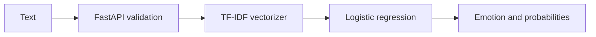

# Emotional Weather Station

An educational NLP classifier using TF-IDF features and a serialized logistic regression model, exposed through FastAPI with a browser frontend.

## Setup

```bash
python -m venv .venv
# Activate the environment
pip install -r requirements.txt
uvicorn main:app --reload
```

Open `/docs` to explore the API. Only load trusted serialized artifacts.

## Example

Send a POST to `/predict` with JSON `{"text":"I am excited about my new project"}`.

## Limitations

Emotion labels are model predictions, not a reliable assessment of a person's mental state. Evaluate macro-F1 and per-class errors on a held-out set. Test empty inputs and restrict allowed origins before production deployment.

## Repository overview

TF-IDF and logistic regression emotion classification with FastAPI and browser UI.

**Suggested GitHub topics:** `nlp` `emotion-classification` `tfidf` `logistic-regression` `fastapi` `scikit-learn`.

## System architecture


